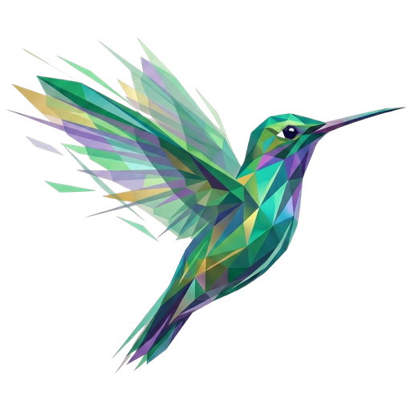

# Aprende Zymbol

> **Revisado para v0.0.8 — 2026-08-05**

> Un lenguaje donde los símbolos hacen el trabajo de las palabras.

Curso estructurado en cuatro niveles — básico, intermedio, avanzado y juegos.  
Del primer `>> "Hola" ¶` a construir un juego de terminal completo, en dos idiomas y con pruebas.  
Sin experiencia previa necesaria.

[Comenzar el curso](basico/README.md)
[Ver en GitHub](https://github.com/zymbol-lang/aprende-zymbol)
